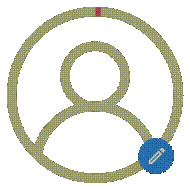

<p align="center">
  
</p>

<h1 align="center">React Picture Selector</h1>

<p align="center">
  A lightweight, accessible, and customizable React component for seamless image uploads, deletions, progress rings, and interactive zoom/pan previews.
</p>

<p align="center">
  <a href="https://www.npmjs.com/package/react-picture-selector"></a>
  <a href="https://bundlephobia.com/package/react-picture-selector"></a>
  <a href="https://github.com/zephinax/react-picture-selector/actions/workflows/ci.yml"></a>
  <a href="https://www.npmjs.com/package/react-picture-selector"></a>
  
  
  <a href="LICENSE"></a>
</p>

<p align="center">
  <strong><a href="https://react-picture-selector.zephinax.com">📖 Live Documentation & Interactive Demo</a></strong> &bull;
  <a href="https://github.com/zephinax/react-picture-selector/releases">GitHub Releases</a>
</p>

---

## ✨ Features

- **Zero CSS Dependencies**: Styled entirely with pure inline CSS. Works out-of-the-box in Next.js, Vite, Remix, or CRA without Tailwind CSS or style loaders.
- **Smooth Upload Animation**: Fluid progress ring (circular avatar) or percentage indicator driven by `requestAnimationFrame` for minimal CPU usage.
- **Interactive Preview Modal**: Click-to-preview modal with smooth zoom controls, track slider, 90° rotation (CW/CCW), click-drag panning, and fullscreen support.
- **Drag & Drop Ready**: Drop images straight onto the component with instant visual feedback and non-image rejection.
- **Offline Test Mode**: Built-in mocked uploads and deletions with custom simulated delays—perfect for demos, prototyping, and automated tests without an API.
- **Request Cancellation**: Native `AbortController` support to cancel in-flight uploads and prevent race conditions.
- **SSR & Next.js Compatible**: Server-side rendering safe with built-in hydration guards.
- **Full Brand Control**: Easily override colors (`primary`, `error`, `progress`, `placeholder`, `text`), sizes, and CSS class slots.

---

## 📦 Installation

```bash
# npm
npm install react-picture-selector

# pnpm
pnpm add react-picture-selector

# bun
bun add react-picture-selector

# yarn
yarn add react-picture-selector
```

> **Note**: `react-picture-selector` requires `react` and `react-dom` (>= 18.0.0). Axios (`^1.8.0`) is included automatically.

---

## 🚀 Quick Start

### Basic Controlled Component

```tsx
import React, { useState } from "react";
import PictureSelector from "react-picture-selector";

export default function ProfilePage() {
  const [avatar, setAvatar] = useState<string | null>(null);

  return (
    <PictureSelector
      title="Profile Picture"
      imageUrl={avatar}
      onChangeImage={(newUrl) => setAvatar(newUrl)}
      testMode={true} // Simulates upload without an API backend
    />
  );
}
```

---

## 🧪 Interactive Test Mode

Want to test your UI without configuring backend endpoints? Enable `testMode`:

```tsx
<PictureSelector
  title="Test Avatar"
  imageUrl={avatar}
  onChangeImage={(newUrl) => setAvatar(newUrl)}
  testMode={true}
  testUploadDelay={1200} // Simulated upload time in ms
/>
```

In test mode, the image will be read locally via `FileReader`, simulated progress will animate smoothly to 100%, and `onChangeImage` will receive the data URL.

---

## ⚙️ Real API Integration

Connect directly to your backend with `apiConfig`:

```tsx
import PictureSelector, { type ProfileSelectorPropsTypes } from "react-picture-selector";

const apiConfig = {
  baseUrl: "https://api.example.com",
  uploadUrl: "/users/avatar",
  deleteUrl: "/users/avatar",
  uploadMethod: "POST",   // "POST" | "PUT" | "PATCH"
  deleteMethod: "DELETE", // "DELETE" | "POST" | "PUT"
  formDataName: "avatar", // Form field name (default: "File")
  responsePath: "data.url", // Dot notation path to extracted image URL
  withCredentials: true,    // Send cookies / session tokens
  uploadHeaders: {
    Authorization: "Bearer your-token",
  },
  deleteHeaders: {
    Authorization: "Bearer your-token",
  },
  onUploadSuccess: (url: string) => console.log("Uploaded successfully:", url),
  onUploadError: (err: any) => console.error("Upload error:", err),
  onDeleteSuccess: () => console.log("Deleted successfully"),
};

export function AvatarUploader() {
  const [imageUrl, setImageUrl] = useState("https://cdn.example.com/user123.jpg");

  return (
    <PictureSelector
      title="Company Avatar"
      imageUrl={imageUrl}
      onChangeImage={(url, rawResponse) => {
        setImageUrl(url);
        console.log("Full backend response:", rawResponse);
      }}
      apiConfig={apiConfig}
    />
  );
}
```

---

## 📋 Component Props Reference

| Prop | Type | Default | Description |
| :--- | :--- | :--- | :--- |
| `imageUrl` | `string \| null` | `null` | Current image URL displayed in the component. |
| `onChangeImage` | `(url: string, responseData?: any) => void` | **Required** | Callback invoked when an image is successfully uploaded or deleted. |
| `type` | `"profile" \| "image"` | `"profile"` | `"profile"` renders a circular avatar with progress ring; `"image"` renders a rectangular container with percentage display. |
| `title` | `string` | `undefined` | Optional title displayed above the selector. |
| `size` | `number` | `180` | Diameter (or width/height) in pixels. |
| `buttonsMinSize` | `number` | `30` | Minimum button size in pixels for touch targets. |
| `viewOnly` | `boolean` | `false` | When `true`, disables upload and delete buttons. Clicking the image opens the preview modal. |
| `colors` | `ColorPalette` | Default Theme | Custom color tokens for buttons, text, and rings. |
| `apiConfig` | `apiConfig` | `undefined` | Network configuration for remote API uploads and deletions. |
| `testMode` | `boolean` | `false` | When `true`, simulates network operations locally. |
| `testUploadDelay` | `number` | `1000` | Delay in milliseconds for simulated upload in test mode. |
| `showProgressRing` | `boolean` | `true` | Whether to display the circular progress ring during upload. |
| `blurOnProgress` | `boolean` | `true` | Blurs the current image while the new upload is in flight. |
| `enableAbortController` | `boolean` | `true` | Enables cancellation of ongoing requests. |
| `debug` | `boolean` | `false` | Logs lifecycle debug info to the browser console. |
| `additionalClassNames` | `object` | `{}` | Custom class slots for `title`, `titleContainer`, `image`, `edit`, and `delete`. |

---

## 🎨 Color Customization

You can customize the color palette by passing a `colors` object:

```tsx
<PictureSelector
  imageUrl={avatar}
  onChangeImage={setAvatar}
  colors={{
    primary: "#6366f1",     // Edit / upload button color
    error: "#ef4444",       // Delete button color
    progress: "#06b6d4",    // Upload progress ring / bar color
    placeholder: "#94a3b8", // SVG avatar placeholder color
    text: "#ffffff",        // Button icon / percentage text color
    textDisabled: "#cbd5e1" // Disabled state color
  }}
/>
```

---

## 🛠️ Development & Testing

```bash
# Run unit & component tests
npm test

# Run tests in watch mode
npm run test:watch

# Build production bundle (ESM + types)
npm run build
```

---

## 📄 License

MIT &copy; [Zephinax](https://github.com/Zephinax)
